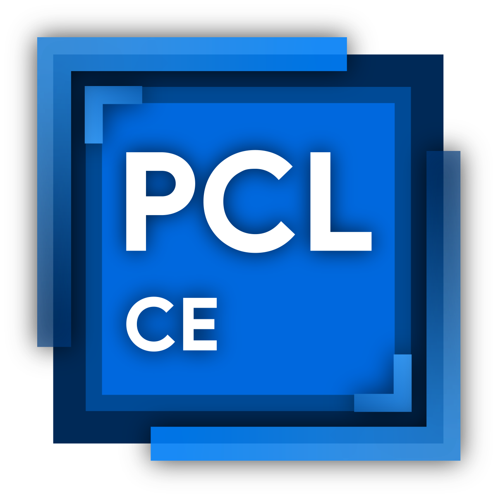

[简体中文](README.md) | **English** | [繁體中文](README-ZH_TW.md)

# PCL Community Edition

  

[Download](https://github.com/PCL-Community/PCL-CE/releases/latest) |
[Upstream repo](https://github.com/Meloong-Git/PCL)

[Submit issues](https://github.com/PCL-Community/PCL-CE/issues/new/choose) |
[Contribution Guidelines](https://github.com/PCL-Community/PCL-CE/wiki/开发指南)

PCL CE is a community edition developed as a secondary project based on PCL’s open-source code. It includes features and improvements that have not yet been implemented in the main branch.

The version numbers of the community edition do not strictly correspond to those of the main branch, so please do not report community edition issues to the official repository.

Everyone is welcome to try it out!

**Developing group:** [599620549](https://qm.qq.com/q/PNQA4Md8wc) | **User group 1:** [1028074835](https://qm.qq.com/q/qrMGJo8BQQ) | **User group 2:** [1070029541](https://qm.qq.com/q/lBywbDMWhG)

## 💻 Supported Platforms

### Windows

| Version | Architecture | Support | Requirements |
|---|---|---|---|
| Windows 10 1809 (17763) or later, or Windows 11 | x64, ARM64 | ✅ Fully supported | [.NET 10 Runtime](https://get.dot.net/10) |
| Windows 10 1607 (E) | x64 | ⚠️ Expected to run; community support offered at discretion | [.NET 10 Runtime](https://get.dot.net/10) |
| Windows 8.1, 8, 7 or earlier | / | ❌ Not supported | / |

<small>`(E)` means Enterprise or ESU editions. .NET 10 officially supports Windows 10 1607 and 1809 only on these editions.</small>

### Linux

| Distribution | Architecture | Support | Requirements |
|---|---|---|---|
| Common glibc desktop distributions (Ubuntu 22.04 or later, Fedora 43 or later, Arch Linux, etc.) | x64 | ✅ Supported | [.NET 10 Runtime](https://get.dot.net/10), X11, Wayland experimental |
| Same as above | ARM64 | ✅ Supported | [.NET 10 Runtime](https://get.dot.net/10), X11 |
| Other glibc desktop distributions | x64, ARM64 | ⚠️ Expected to run; community support offered at discretion | Requires glibc 2.27 or later and a working X11 desktop |
| Alpine and other musl distributions | x64, ARM64 | ❌ Not supported | Current artifacts have not been tested on musl |

<small>X11 is used by default. Set `PCL_USE_WAYLAND=1` to try native Wayland. If initialization fails, it falls back to X11 automatically. Wayland also requires `libwayland-client` and `libxkbcommon`.</small>

### macOS

| Version | Architecture | Support | Requirements |
|---|---|---|---|
| macOS 12 or later | Apple Silicon (ARM64) | ✅ Supported | [.NET 10 Runtime](https://get.dot.net/10) |
| Intel-based macOS | x64 | ❌ Not supported | / |

<small>Intel (x64) macOS builds are no longer provided.</small>

**✅ Fully supported**: We will provide as much support as possible. Please make sure you are using the latest version.

**⚠️ Expected to run; community support offered at discretion**: These platforms usually work, but we cannot guarantee that every feature will work correctly. The community will help when possible. Upgrading to a supported OS version gives you more complete support.

**❌ Not supported**: These platforms generally cannot run PCL CE, and may not even start. Please upgrade your system before using PCL CE.

**Note**:
- The community only supports the latest version of the launcher.
- Some issues depend on the system environment. For example, if system components are incomplete, you may still need to upgrade your system to get further support.
- We recommend a newer OS for a better experience.
- You can still try running PCL CE on unsupported systems, but you may run into more problems.

## 🔒 License

- `PCL.Launcher/` and `PCL.Launcher.Core/` use [Custom License](https://github.com/PCL-Community/PCL-CE/blob/dev/PCL.Launcher.Core/LICENCE)
- `All other directories` use [Apache License 2.0](https://github.com/PCL-Community/PCL-CE/blob/dev/LICENSE)

## 🌟 Statistic

**Views** (Total / Today): 
## ❤️ Contributors

