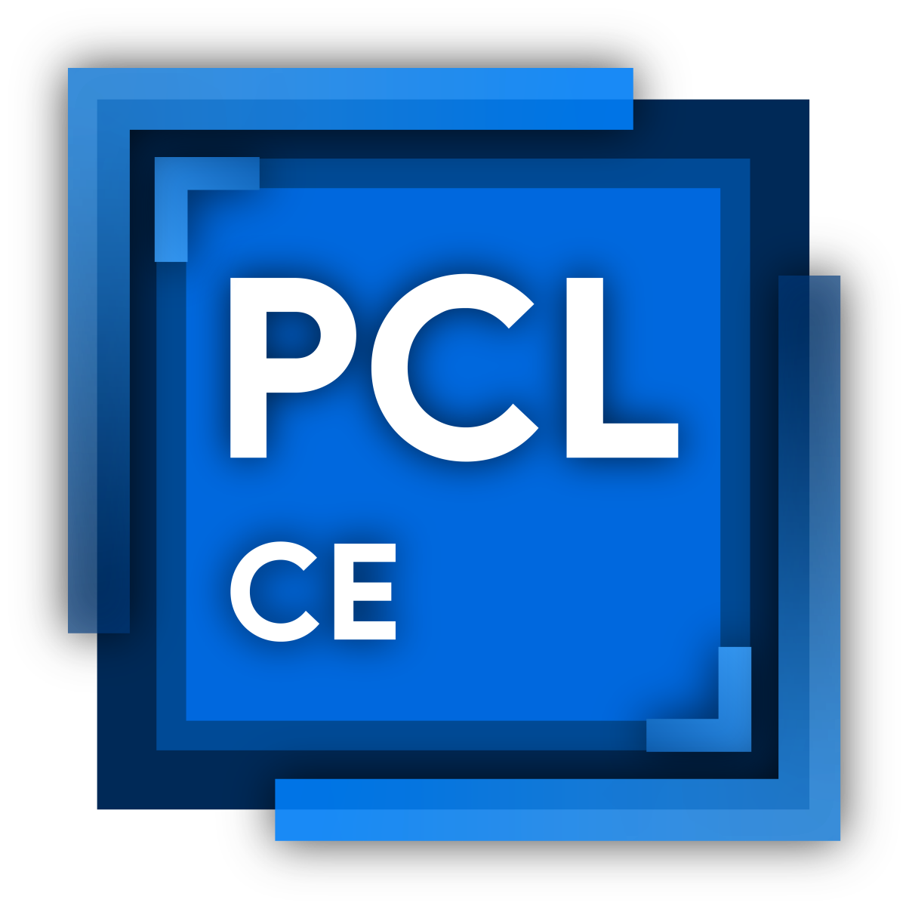

[简体中文](README.md) | [English](README-EN.md) | **繁體中文**

# PCL Community Edition

  

[社群版下載](https://github.com/PCL-Community/PCL-CE/releases/latest) |
[上游儲存庫](https://github.com/Meloong-Git/PCL)

[提交問題](https://github.com/PCL-Community/PCL-CE/issues/new/choose) |
[貢獻指南](https://github.com/PCL-Community/PCL-CE/wiki/开发指南)

PCL CE 是基於 PCL 開放原始碼二次開發的社群版本，包括了主線暫未製作的功能和改進！

社群版的版本號與主線並非嚴格對應關係，也請不要向官方儲存庫回饋社群版問題。

歡迎大家來用用看！

**開發群:** [599620549](https://qm.qq.com/q/PNQA4Md8wc) | **使用者 1 群:** [1028074835](https://qm.qq.com/q/qrMGJo8BQQ) | **使用者 2 群:** [1070029541](https://qm.qq.com/q/lBywbDMWhG)

## 💻 支援平台

### Windows

| 版本 | 架構 | 支援情況 | 環境要求 |
|---|---|---|---|
| Windows 10 1809 (17763) 及以上，或 Windows 11 | x64、ARM64 | ✅ 完整支援 | [.NET 10 Runtime](https://get.dot.net/10) |
| Windows 10 1607 (E) | x64 | ⚠️ 理論能跑，酌情提供社群支援 | [.NET 10 Runtime](https://get.dot.net/10) |
| Windows 8.1、8、7 及更低版本 | / | ❌ 不支援 | / |

`(E)` 指 Enterprise 或 ESU 版本。.NET 10 對 Windows 10 1607 和 1809 的官方支援僅限這些版本。

### Linux

| 發行版 | 架構 | 支援情況 | 環境要求 |
|---|---|---|---|
| 常見 glibc 桌面發行版 （Ubuntu 22.04 及以上、Fedora 43 及以上、Arch Linux 等） | x64 | ✅ 支援 | [.NET 10 Runtime](https://get.dot.net/10)、X11、Wayland 實驗 |
| 同上 | ARM64 | ✅ 支援 | [.NET 10 Runtime](https://get.dot.net/10)、X11 |
| 其他 glibc 桌面發行版 | x64、ARM64 | ⚠️ 理論能跑，酌情提供社群支援 | 需要 glibc 2.27 及以上，並能使用 X11 桌面 |
| Alpine 等 musl 發行版 | x64、ARM64 | ❌ 不支援 | 目前產物尚未在 musl 環境驗證 |

預設使用 X11。設定 `PCL_USE_WAYLAND=1` 可以嘗試原生 Wayland。如果初始化失敗，會自動回退到 X11。使用 Wayland 還需要安裝 `libwayland-client` 和 `libxkbcommon`。

### macOS

| 版本 | 架構 | 支援情況 | 環境要求 |
|---|---|---|---|
| macOS 12 及以上 | Apple Silicon (ARM64) | ✅ 支援 | [.NET 10 Runtime](https://get.dot.net/10) |
| Intel 版 macOS | x64 | ❌ 不支援 | / |

macOS 不再提供 Intel（x64）版本。

**✅ 完整支援**：會盡量提供支援，但請先確保使用最新版本。

**⚠️ 理論能跑，酌情提供社群支援**：這些平台通常可以執行，但無法保證所有功能正常。遇到問題時，社群會視情況協助。升級到受支援的系統版本可以獲得更完整的支援。

**❌ 不支援**：這些平台基本無法正常使用，甚至可能無法啟動。請升級系統後再執行 PCL CE。

**注**：
- 社群只為最新版本提供支援。
- 有些問題與系統環境有關。例如系統元件不完整時，仍需升級系統才能繼續獲得支援。
- 建議使用較新的作業系統，以獲得更好的體驗。
- 在不受支援的系統上仍可嘗試執行，但可能遇到更多問題。

## 🔒 授權條款

- `PCL.Launcher/` 和 `PCL.Launcher.Core/` 使用 [自訂授權條款](https://github.com/PCL-Community/PCL-CE/blob/dev/PCL.Launcher.Core/LICENCE)
- `其餘所有目錄` 使用 [Apache License 2.0](https://github.com/PCL-Community/PCL-CE/blob/dev/LICENSE)

## 🌟 統計資料

**此頁瀏覽量**（總計 / 今日）：
## ❤️ 貢獻者

