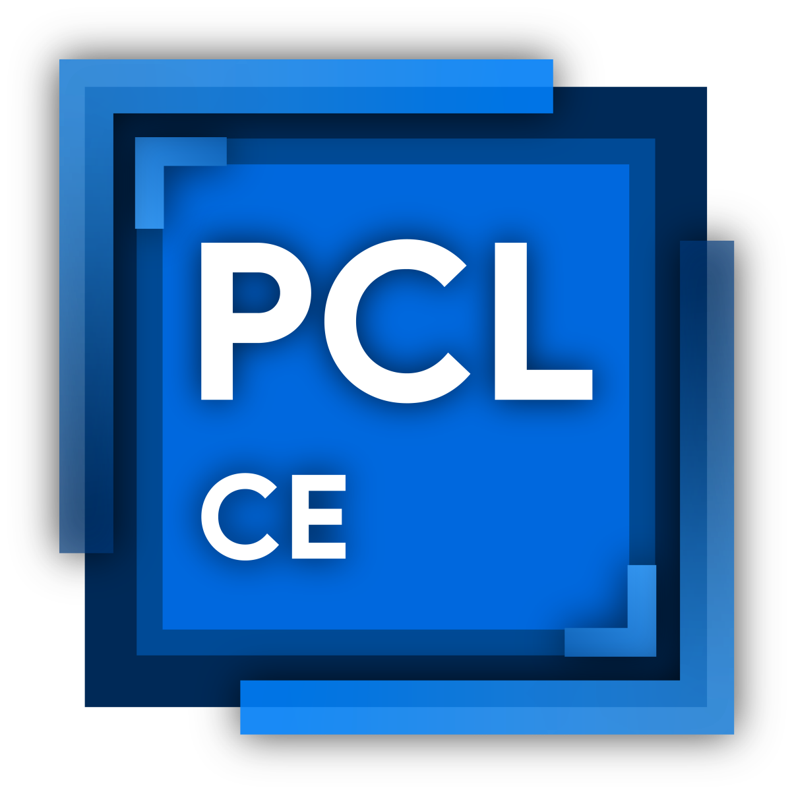

**简体中文** | [English](README-EN.md) | [繁體中文](README-ZH_TW.md)

# PCL Community Edition

  

[社区版下载](https://github.com/PCL-Community/PCL-CE/releases/latest) |
[上游存储库](https://github.com/Meloong-Git/PCL)

[提交问题](https://github.com/PCL-Community/PCL-CE/issues/new/choose) |
[贡献指南](https://github.com/PCL-Community/PCL-CE/wiki/开发指南)

PCL CE 是基于 PCL 开源代码二次开发的社区版本，包括了主线暂未制作的功能和改进！

社区版的版本号与主线并非严格对应关系，也请不要向官方仓库反馈社区版问题。

欢迎大家来用用看！

**开发群:** [599620549](https://qm.qq.com/q/PNQA4Md8wc)[✦](https://t.me/+78XW2bUOvKJjMTZl) | **用户 1 群:** [1028074835](https://qm.qq.com/q/qrMGJo8BQQ) | **用户 2 群:** [1070029541](https://qm.qq.com/q/lBywbDMWhG)

## 💻 支持平台

### Windows

| 版本 | 架构 | 支持情况 | 环境要求 |
|---|---|---|---|
| Windows 10 1809 (17763) 及以上，或 Windows 11 | x64、ARM64 | ✅ 完整支持 | [.NET 10 Runtime](https://get.dot.net/10) |
| Windows 10 1607 (E) | x64 | ⚠️ 理论能跑，酌情提供社区支持 | [.NET 10 Runtime](https://get.dot.net/10) |
| Windows 8.1、8、7 及更低版本 | / | ❌ 不支持 | / |

<small>`(E)` 指 Enterprise 或 ESU 版本。.NET 10 对 Windows 10 1607 和 1809 的官方支持仅限这些版本。</small>

### Linux

| 发行版 | 架构 | 支持情况 | 环境要求 |
|---|---|---|---|
| 常见 glibc 桌面发行版 （Ubuntu 22.04 及以上、Fedora 43 及以上、Arch Linux 等） | x64 | ✅ 支持 | [.NET 10 Runtime](https://get.dot.net/10)、X11、Wayland 实验 |
| 同上 | ARM64 | ✅ 支持 | [.NET 10 Runtime](https://get.dot.net/10)、X11 |
| 其他 glibc 桌面发行版 | x64、ARM64 | ⚠️ 理论能跑，酌情提供社区支持 | 需要 glibc 2.27 及以上，并能使用 X11 桌面 |
| Alpine 等 musl 发行版 | x64、ARM64 | ❌ 不支持 | 当前产物尚未在 musl 环境验证 |

<small>默认使用 X11。设置 `PCL_USE_WAYLAND=1` 可以尝试原生 Wayland。如果初始化失败，会自动回退到 X11。使用 Wayland 还需要安装 `libwayland-client` 和 `libxkbcommon`。</small>

### macOS

| 版本 | 架构 | 支持情况 | 环境要求 |
|---|---|---|---|
| macOS 12 及以上 | Apple Silicon (ARM64) | ✅ 支持 | [.NET 10 Runtime](https://get.dot.net/10) |
| Intel 版 macOS | x64 | ❌ 不支持 | / |

<small>macOS 不再提供 Intel（x64）版本。</small>

**✅ 完整支持**：会尽量提供支持，但请先确保使用最新版本。

**⚠️ 理论能跑，酌情提供社区支持**：这些平台通常可以运行，但无法保证所有功能正常。遇到问题时，社区会视情况协助。升级到受支持的系统版本可以获得更完整的支持。

**❌ 不支持**：这些平台基本无法正常使用，甚至可能无法启动。请升级系统后再运行 PCL CE。

**注**：
- 社区只为最新版本提供支持。
- 有些问题与系统环境有关。例如系统组件不完整时，仍需升级系统才能继续获得支持。
- 建议使用较新的操作系统，以获得更好的体验。
- 在不受支持的系统上仍可尝试运行，但可能遇到更多问题。

## 🔒 许可证

- `PCL.Launcher/` 和 `PCL.Launcher.Core/` 使用 [自定义许可证](https://github.com/PCL-Community/PCL-CE/blob/dev/PCL.Launcher.Core/LICENCE)
- `其余所有目录` 使用 [Apache License 2.0](https://github.com/PCL-Community/PCL-CE/blob/dev/LICENSE)

## 🌟 统计数据

**此页浏览量**（总计 / 今日）：
## ❤️ 贡献者

